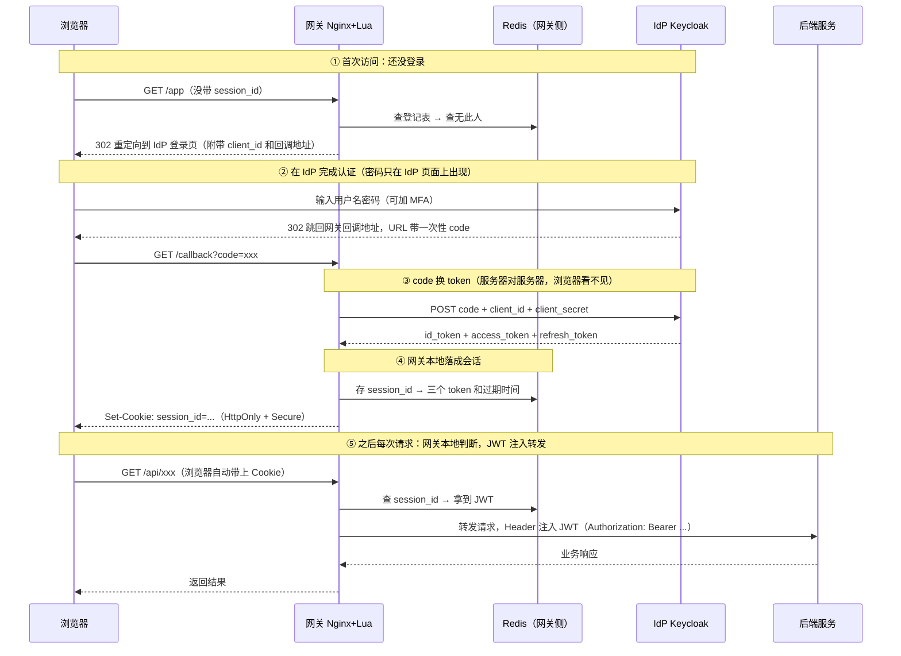

## Table of contents

# 1. 先说清一件事：SSO 到底在解决什么

公司里有 5 个系统：邮件、报销、代码仓库、监控、存储管理平台。没有 SSO 的世界是：每个系统一套账号密码，每天登录 5 次，离职时要到 5 个地方删账号。

**SSO（Single Sign-On，单点登录）就是：登录一次，所有系统都认识你。**

但"登录一次、处处通行"不是魔法，它要解一个具体的难题：每个系统都要确认"你是谁"，可它们**都不该各自再问你要一次密码**——那样密码就得在每个系统里存一份，任何一处泄露全盘失守。

所以整个机制的设计目标可以浓缩成一句话：**密码只在身份提供方那里出现一次，其他系统通过"可信的证件"来认识你。**

## 两个容易混淆的动词

后面所有概念都建立在区分这两个词上：

- **认证（Authentication）**：确认你是**谁**（掏出身份证看脸）
- **授权（Authorization）**：确认你能**做什么**（查你有没有门禁权限）

SSO 的核心是**认证**。而 OAuth2 其实是个**授权**协议——它本来的用途是"允许 A 应用代表你访问 B 的资源"（比如允许某 App 读取你的 GitHub 仓库列表），并不回答"你是谁"。**OIDC 才是在 OAuth2 之上补出来的认证层**。很多人把四个名词混为一谈，根源就在这里。读完全文你会回来复习第 5 节那张对照表。

# 2. 一局的五个角色

先把参与者认全，后面时序图里每个箭头才知道是谁在跟谁说话。

| 角色 | 是什么 | 职责 |
| --- | --- | --- |
| 浏览器 | 你手里的客户端 | 跟随重定向、自动携带 Cookie |
| 网关 | Nginx + Lua（OpenResty） | 所有请求的入口：查登录状态、代理转发 |
| Redis | 网关旁边的存储 | 存"已登录会话"的登记表 |
| IdP | Keycloak / Okta / Azure AD | 权威身份源：存用户库、验密码、签发 token |
| 后端服务 | 真正的业务系统 | 干活，但不负责登录 |

**记忆锚点**：IdP 是派出所（发证件），网关是小区门卫（查证件），Redis 是门卫手里的登记表，后端是你要进的那栋楼。

注意一个容易误解的点：**网关不认识任何用户，也没有用户库**。它只信任派出所签发的证件，大部分请求只翻自己的登记表——这正是网关能保持高性能的原因，只有登记表里没有或过期了才真的去问派出所。

**那张 Redis 登记表是网关的，不是 IdP 的。** IdP 发完 token 就不跟踪"谁在访问哪个应用"——它可能同时服务几十个应用，如果每个应用的会话都归 IdP 管，IdP 就成了所有请求的必经之路和单点瓶颈。所以每个接入方（网关）各自保管自己的会话。

由此引出整个体系里其实有**两层会话**，分工完全不同：

| | IdP 侧会话 | 网关侧 Redis 会话 |
| --- | --- | --- |
| 存哪 | IdP 自己的存储（Keycloak 用 Infinispan） | 网关旁边的 Redis |
| 凭证 | 浏览器里 IdP 域下的 SSO Cookie | 浏览器里网关域下的 session_id Cookie |
| 管什么 | **跨系统**：还要不要你重新输密码 | **单系统**：这次访问放不放行 |

你在 A 系统登录过后，IdP 给自己种了 SSO Cookie。之后你去 B 系统，302 跳到 IdP 时它发现 Cookie 还在，就直接发 code 跳回去、不再让你输密码——**"单点"体验的来源是 IdP 侧这层会话**。而 B 系统网关侧的流程（换 token、写自己那张 Redis）照走不误，和 A 系统互不干扰。

# 3. 完整流程：一次登录发生了什么

这是全文的核心。先看总图，再逐步拆"为什么"。

## 逐步拆解：每一步为什么这样设计

### ① 为什么是 302 跳去 IdP 登录页，而不是业务系统自己弹个密码框

这是整个体系的**第一原则：密码只在 IdP 的页面上出现**。如果业务系统自己做登录框，密码就要经它的手——每多一个经手的系统，泄露面就大一圈。302 跳转把"碰密码"这件事收拢到唯一一个地方，这也是浏览器地址栏变成 IdP 域名给你提供的**天然提示**（地址栏不对就别输密码，防钓鱼）。

### ② IdP 为什么不直接发 token，而是先给一个一次性的 code

因为**这个 code 会经过浏览器地址栏**——它可能留在浏览历史、代理日志、Referer 头里，是个"半公开"的东西。设计者的应对是：**让 code 单独没用**。

### ③ code 换 token：整个流程里最关键的一步

换 token 的请求是**网关服务器直接发给 IdP 的**（不经过浏览器），并且必须同时出示 `client_id + client_secret`。client_secret 只存在于网关服务器上，浏览器永远看不到。

所以即使 code 被截获，攻击者没有 client_secret 也换不出任何东西——code 只是一张"取件凭条"，token 才是"证件"，取件必须凭条和密钥一起出示。同时 code 通常**几分钟内过期、只能用一次**，把泄露后的可用窗口压到最小。

**这三样东西各是谁的？**（高频误解点）

| 东西 | 属于谁 | 类比 |
| --- | --- | --- |
| code | 这次登录的一次性凭条（绑定了该用户 + 该应用），**本身不含用户信息** | 快递取件码 |
| client_id | **网关**在 IdP 注册时拿到的公开身份（就在 URL 里，人人可见） | 公司名 |
| client_secret | **网关**的密钥，只存在网关服务器上，IdP 留有登记 | 公章 |

注意区分：**code 里并没有用户信息**——用户信息在换回来的 id_token 里（比如 sub、name 这些 claim）。client_id/secret 也不是 IdP 的，而是**应用自己的身份**：网关拿三件套来换 token 时，IdP 核对"这个 client_id 注册过吗？secret 对得上吗？code 是我刚发出去的那张吗？"，三个都对才发 token。

### ④ 网关为什么不把 JWT 直接给浏览器，而是换成 session_id

三个 token 到网关手里后，网关做了一次"落地"：把真 token 存进 Redis，浏览器只收到一个无信息量的随机串 `session_id`（放在 HttpOnly Cookie 里，JS 读不到）。这样做的收益：

- **泄露面小**：就算 XSS 偷走了 Cookie，攻击者拿到的只是一个随机串，真正的 JWT 从未离开服务端
- **可主动吊销**：Redis 删一条记录 = 该用户立刻下线——这对"离职立即停权"这种场景是刚需
- **代价**：服务端变成有状态（要维护 Redis），这就是第 6 节讨论的取舍

### ⑤ 后端怎么知道你是谁：JWT 在这里才真正出场

网关从 Redis 取出 JWT，放进 `Authorization: Bearer <jwt>` 请求头转发给后端。后端**不查库、不问 IdP**，用 IdP 的公钥（从 IdP 公开的 jwks_uri 下载）在本地验证签名，然后从 payload 里读 `sub`（用户 ID）和角色。这就是为什么 JWT 要自带签名——**验证成本被摊到每个后端本地完成**，IdP 不会成为每次请求的瓶颈。

# 4. 过期了怎么办：refresh token 的静默续期

设计上，access token 短命（常见 5 分钟～1 小时），refresh token 长命（常见几天～30 天）。网关拿到 JWT 后发现快过期时，用 refresh_token 找 IdP 静默换一组新 token、更新 Redis 记录，用户完全无感。

**为什么这样分**：

- access token 短命 → 即使泄露，可用窗口也小
- refresh token 长命但**只能用于换新**，且只在网关↔IdP 之间流动，从不接触浏览器和后端 → 泄露面极小

真正的主动下线则更简单：删 Redis 记录，下次请求直接被网关打回登录页。

# 5. 四个名词回到一起（现在这是复习，不是门槛）

| 概念 | 是什么 | 在上面流程里的位置 |
| --- | --- | --- |
| **SSO** | 目标/体验 | 登录一次，处处通行 |
| **OIDC** | 认证协议 | 第 ②③ 步（登录 + code 换 token，多返回一个 id_token） |
| **OAuth2** | 授权框架 | OIDC 的地基：code 换 token 这套机制就是它的授权码模式 |
| **JWT** | token 的编码格式 | id_token / access_token 的载体：header.payload.signature，自带签名 |

**一句话串起来**：SSO 是想要的体验 → 用 OIDC 做认证来实现 → OIDC 复用 OAuth2 的授权码机制做底座 → 三个 token 用 JWT 格式承载。

# 6. Token vs Session：不是二选一，而是各管一段

| | JWT（自包含） | Session（引用式） |
| --- | --- | --- |
| 谁产生 | IdP 签发 | 网关自己生成 |
| 内容 | 自带用户信息 + 签名 | 空壳随机串，信息在 Redis |
| 验起来 | 本地验签即可，零查询 | 必须查一次 Redis |
| 吊销 | 做不到（签名不过期就有效） | 删记录立即生效 |
| 适合 | 网关 → 后端的内部传递 | 浏览器 → 网关的对外暴露面 |

回看流程会发现：**对外（浏览器）用 session，对内（后端）用 JWT**，各取所长。`session_id` 本身不是 JWT——它是个不透明随机串，必须配合 Redis 才有意义，这是它和自包含 JWT 最本质的区别。

# 7. 为什么公司 SSO 选 Nginx + Lua

- **性能**：Lua 通过 OpenResty 嵌进 Nginx 请求处理阶段（`access_by_lua`），协程 + 非阻塞 I/O，鉴权几乎零额外延迟，不用为每个请求额外跳转后端鉴权服务
- **入口拦截**：在流量入口决定放行与否，后端零压力
- **生态成熟**：`lua-resty-openidc` / `lua-resty-jwt` / `lua-resty-session` 把 OIDC 校验和 session 管理都封装好了
- **复用基建**：Nginx 本来就在做反向代理/负载均衡，加 Lua 是顺手扩展
- **热更新**：Lua 脚本可不重启 Nginx 热加载

# 8. 附录 A：Keycloak 界面速查

（按需阅读——理解流程不需要它，配环境时才用得上）

- **Realm**：独立租户空间，Realm 之间用户和配置完全隔离
- **Clients**：注册"谁可以来做 OIDC 认证"。网关本身就是一个 Confidential Client（持有 client_id + client_secret），在这里配 redirect_uri 和 token 有效期
- **Users / User Federation**：本地用户库，或对接 LDAP/AD
- **Roles / Groups**：权限模型，可映射进 JWT 的 claim
- **Realm Settings → Endpoints**：OpenID Endpoint Configuration（即 discovery URL），`lua-resty-openidc` 靠它自动发现 authorization_endpoint、token_endpoint、jwks_uri

配置顺序：Keycloak 建 Client 拿 client_id/secret → 网关 `lua-resty-openidc` 填 discovery URL + client_id/secret → 用户走 Keycloak/LDAP 登录 → 登录成功后按 redirect_uri 把 code 送回网关 → 网关完成第 ③④ 步。

# 9. 附录 B：mTLS 什么时候需要

- **用户登录场景不需要**：浏览器 + 密码 + 单向 TLS 足够
- **mTLS（双向 TLS）用在机器对机器**：服务间调用、零信任服务网格、金融/政企高安全内网
- 证书验证分两层：TLS 握手层用 Nginx 原生 `ssl_verify_client`（安全关键路径，不建议用 Lua 重写）；握手后取证书字段做业务级授权可以用 `access_by_lua` 扩展
